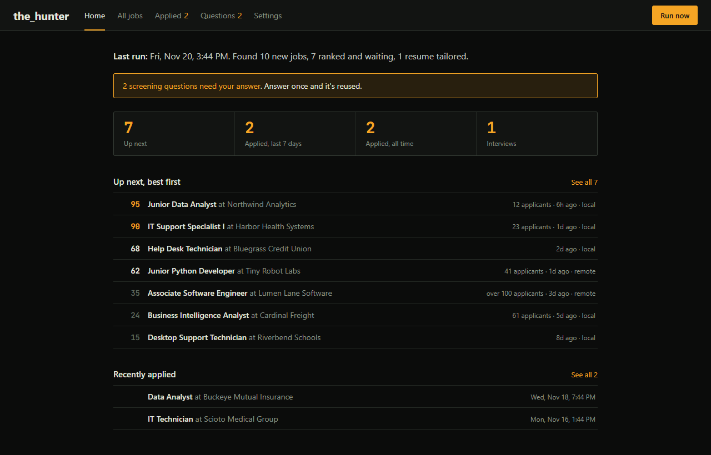
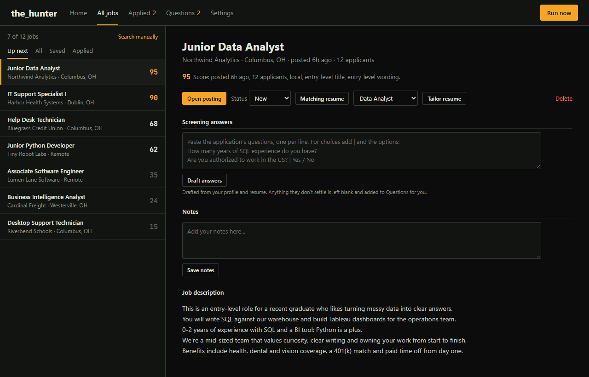
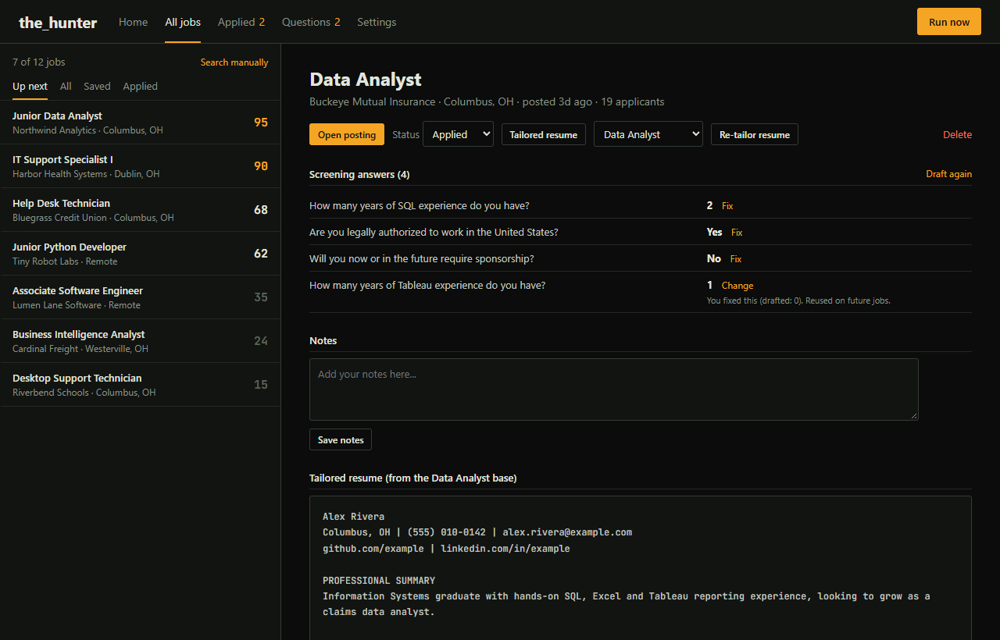

# the_hunter

A local job-search assistant. On a daily schedule or on demand, it searches job boards, throws out the junk, ranks what's left by how likely an application is to get a response, picks (or tailors) the right resume, and drafts answers to screening questions. Then you open the best postings and apply yourself.

It never submits an application. That's on purpose: the slow, judgment-heavy part of applying is choosing where to apply and getting the details right, and that's the part this automates.



## What it does

**Search.** Runs your saved searches (title + location + remote) on LinkedIn, Indeed, ZipRecruiter and Glassdoor through [jobspy](https://github.com/speedyapply/JobSpy). If you save a logged-in LinkedIn session, LinkedIn is searched through a real browser instead (Playwright), which gets applicant counts, a remote filter that actually works, and skips jobs you've already applied to. Duplicates and cross-posts are dropped.

**Filter.** Each skipped job keeps a note saying why.
- **Scam postings:** "no experience required, message us on WhatsApp" wording, personal email addresses, bank-account talk, and *clone postings*: the same description posted under 4+ unrelated "companies" (`services/scam_filter.py`).
- **C2C staffing vendors:** postings that talk like corp-to-corp vendors (C2C, prime vendor, visa-status lists), with negation handling so "No C2C" doesn't trip it, plus your own blocklist (`services/staffing_filter.py`).
- **Out of reach:** senior titles, non-tech roles that share words with IT titles ("HVAC service technician"), and software jobs asking for 3+ years. Parsing "years of experience" is fiddlier than it looks: ranges, "minimum of", "nice to have", "30+ years in business" (`services/ranking.py`).
- **Your excluded locations.**

**Rank.** Every job gets a score with its reasons shown: posting age, applicant count, local vs. remote, entry-level wording, required years. With a LinkedIn session, the most promising jobs get their page read first for applicant count and the full description.



**Resumes.** Each job is matched to one of three base resumes (data / IT / software). Optionally Claude (Opus) tailors it to the posting under strict rules: no invented experience, skills or numbers, just reordering and rewording what's there. The result is rendered to a clean PDF.

**Screening answers.** Paste an application's questions and Claude (Sonnet, structured output) drafts answers from your profile facts and resume. Answers you've given before are reused without an API call. Anything the facts don't settle is left blank, not guessed, and lands in *Questions for you*. Answer it once and it's reused from then on. Fix a drafted answer and the fix is reused too.



## Try it (no API key needed)

```bash
python -m venv .venv
.venv\Scripts\activate          # macOS/Linux: source .venv/bin/activate
pip install -r requirements.txt
playwright install chromium

python -m backend.demo          # fake candidate + fake jobs
uvicorn backend.main:app --port 8000
```

Open http://localhost:8000. The demo uses a made-up candidate (`examples/`) and made-up companies; the scores and filter notes come from the real code.

## Use it for real

1. `cp .env.example .env` and add an `ANTHROPIC_API_KEY` (needed for tailoring and screening answers only).
2. Put your base resumes in a folder as `resume_data.docx`, `resume_it.docx`, `resume_software.docx` (optionally a `.pdf` of each) and set `RESUME_DIR` in `.env`.
3. Edit `data/applicant_profile.json` (created on first run) with your own facts.
4. Optional: `python -m backend.linkedin_login` opens a browser so you can log in to LinkedIn by hand; the session is saved to `data/` and used for search. Your password is never stored.
5. `python -m backend.demo --reset` is only for the demo. For real use, delete `data/the_hunter.db` if you loaded the demo, start the app, add searches under **Settings**, and click **Run now** (or turn on the daily schedule).

Everything personal (database, profile, LinkedIn session, generated resumes) lives in `data/`, which is git-ignored.

On Windows, `start_the_hunter.bat` / `stop_the_hunter.bat` run it in the background.

## How it's built

- **Backend:** Python, FastAPI, SQLAlchemy + SQLite, APScheduler for the daily run
- **Search:** jobspy; Playwright for logged-in LinkedIn search (read-only: search results and job pages)
- **LLM:** Anthropic SDK: Claude Opus for tailoring, Claude Sonnet with structured output for screening answers
- **Documents:** python-docx to read base resumes, fpdf2 to render PDFs
- **Frontend:** one HTML file, vanilla JS, no build step

```
backend/
  main.py                 FastAPI app, serves the UI
  demo.py                 fake demo data
  linkedin_login.py       save a logged-in LinkedIn session (by hand)
  routers/                jobs, settings + run, resume tailoring, screening answers
  services/
    scheduler.py          the pipeline: search -> filter -> rank -> resume
    ranking.py            scoring + "years of experience" parsing
    scam_filter.py        scam wording + clone-posting detection
    staffing_filter.py    C2C vendor wording + your blocklist
    location_filter.py    your excluded locations
    linkedin_search.py    logged-in LinkedIn search (Playwright)
    job_scraper.py        jobspy search
    resumes.py            base resume per track, job -> track
    resume_tailor.py      Claude tailoring
    form_answers.py       Claude screening answers + saved answers
    pdf_generator.py      resume text -> PDF
frontend/index.html
tests/                    filters, ranking, tracks (pytest)
```

## Notes

Automated access to LinkedIn may conflict with its terms of service. Logged-in search is opt-in, paced, and read-only; use it at your own discretion. Without a saved session, LinkedIn is searched through jobspy's public search like the other boards.

Run the tests with `pytest`.

## License

MIT, see [LICENSE](LICENSE).
